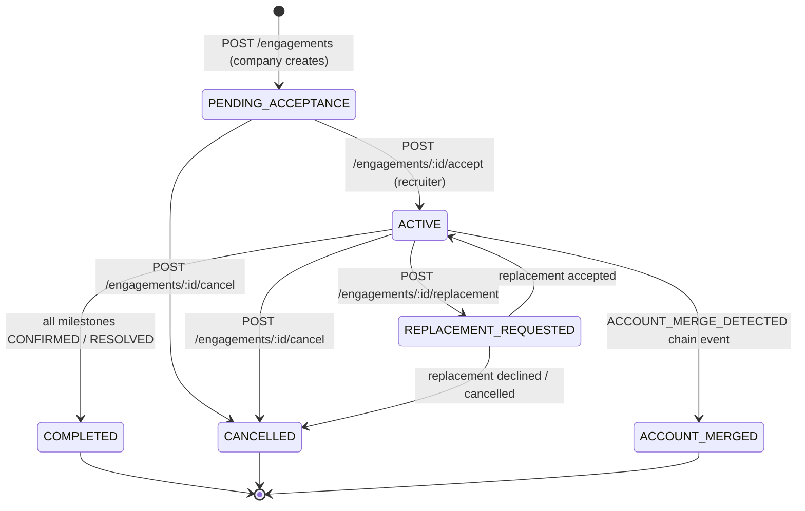
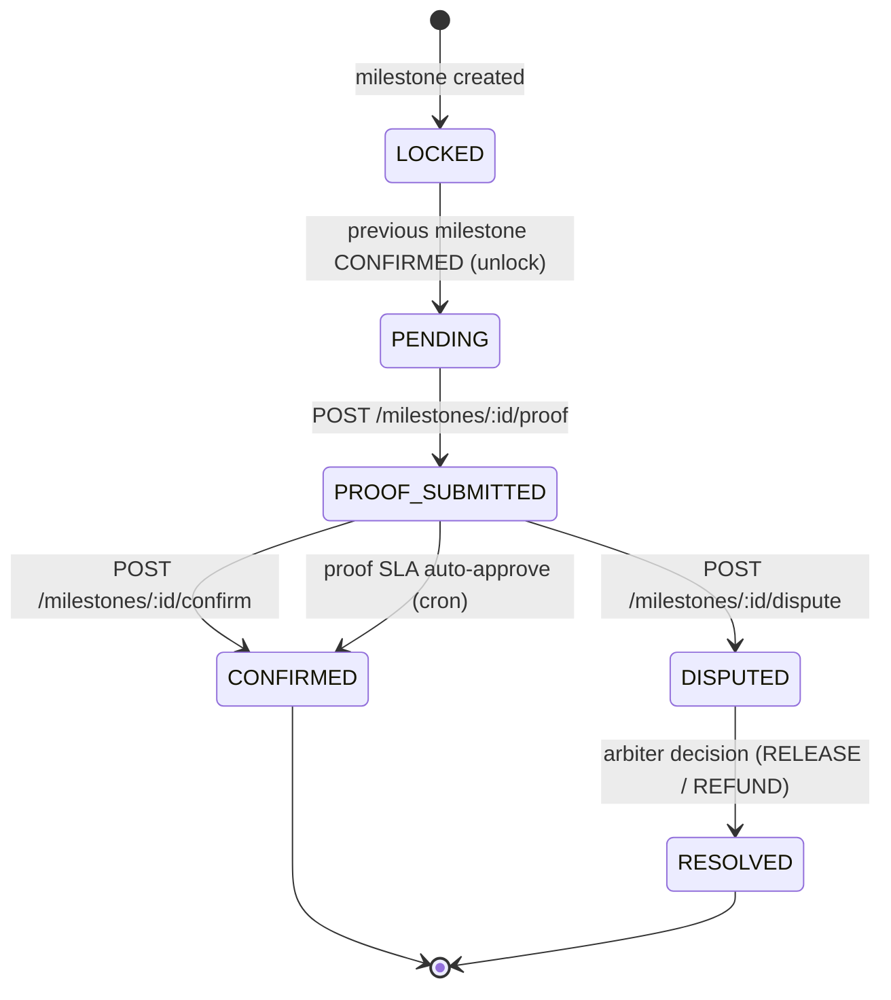

# Engagement & Milestone Lifecycle

This document describes the state machines for `EngagementStatus` and
`MilestoneStatus`, the events that drive each transition, and how the
retention scheduler, auto-escalation, partial releases and proof versions
fit into the lifecycle.

The enums below mirror `prisma/schema.prisma` and the on-chain contract
enums. If you change an enum there, update this document in the same PR.

## EngagementStatus

| Transition | Trigger |
| --- | --- |
| `[*] → PENDING_ACCEPTANCE` | `POST /engagements` — company creates the engagement |
| `PENDING_ACCEPTANCE → ACTIVE` | `POST /engagements/:id/accept` — recruiter accepts |
| `PENDING_ACCEPTANCE → CANCELLED` | `POST /engagements/:id/cancel` |
| `ACTIVE → COMPLETED` | All milestones reach `CONFIRMED` or `RESOLVED` |
| `ACTIVE → CANCELLED` | `POST /engagements/:id/cancel` |
| `ACTIVE → REPLACEMENT_REQUESTED` | `POST /engagements/:id/replacement` |
| `REPLACEMENT_REQUESTED → ACTIVE` | Replacement candidate accepted |
| `REPLACEMENT_REQUESTED → CANCELLED` | Replacement declined or engagement cancelled |
| `ACTIVE → ACCOUNT_MERGED` | `ACCOUNT_MERGE_DETECTED` chain event (duplicate Stellar account detected) |

## MilestoneStatus

| Transition | Trigger |
| --- | --- |
| `[*] → LOCKED` | Milestone created with the engagement |
| `LOCKED → PENDING` | Previous milestone `CONFIRMED` — `MILESTONE_UNLOCKED` notification |
| `PENDING → PROOF_SUBMITTED` | `POST /milestones/:id/proof` — recruiter uploads proof |
| `PROOF_SUBMITTED → CONFIRMED` | `POST /milestones/:id/confirm` — company confirms |
| `PROOF_SUBMITTED → CONFIRMED` | Proof SLA cron when `proofSlaAction = AUTO_APPROVE` |
| `PROOF_SUBMITTED → DISPUTED` | `POST /milestones/:id/dispute` |
| `DISPUTED → RESOLVED` | Arbiter decision (`DisputeOutcome.RELEASE` or `REFUND`) |

## Retention scheduler

`RETENTION` milestones (`MilestoneKind.RETENTION`) are not unlocked by the
previous milestone. Instead the retention scheduler watches the engagement's
placement confirmation date and, once the retention window is reached,
moves the milestone from `LOCKED` to `PENDING` and emits
`RETENTION_WINDOW_APPROACHING` ahead of time. From there the normal
`PROOF_SUBMITTED → CONFIRMED` flow applies.

## Auto-escalation

When a proof sits in `PROOF_SUBMITTED` past the company's `proofSlaDays`,
the proof SLA cron applies `User.proofSlaAction`:

- `AUTO_APPROVE` — the milestone is confirmed automatically.
- `ESCALATE_TO_ADMIN` — the milestone stays `PROOF_SUBMITTED` and an admin
  is notified so they can confirm or open a dispute.

## Partial releases

A company may release part of a milestone's funds before full confirmation
(`PartialReleaseStatus`: `PROPOSED → EXECUTED | REJECTED | FAILED`). The
remainder is handled per `PartialRemainderAction` (`REFUND` or `RETAIN`).
Partial releases do not change `MilestoneStatus`; they only move funds and
emit `PAYMENT_RELEASED`.

## Proof versions

Each proof upload creates a `ProofVersion` (`ProofVersionStatus`:
`SUBMITTED → APPROVED | REJECTED`). A rejected version keeps the milestone
in `PROOF_SUBMITTED` so the recruiter can submit a new version; only an
`APPROVED` version drives the transition to `CONFIRMED`.
